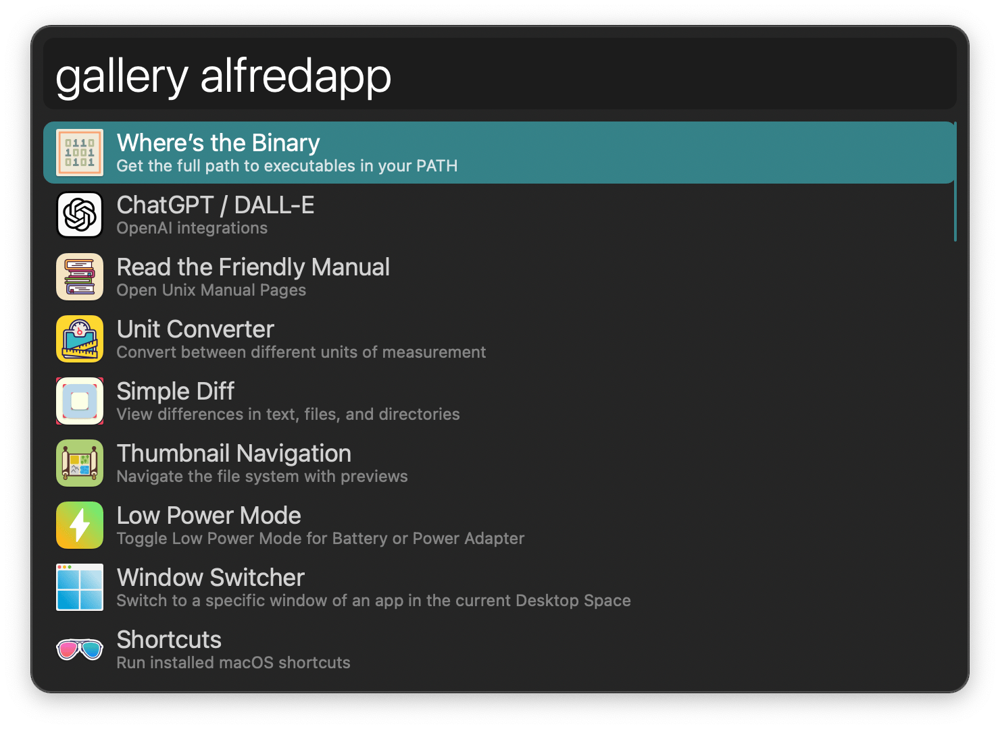
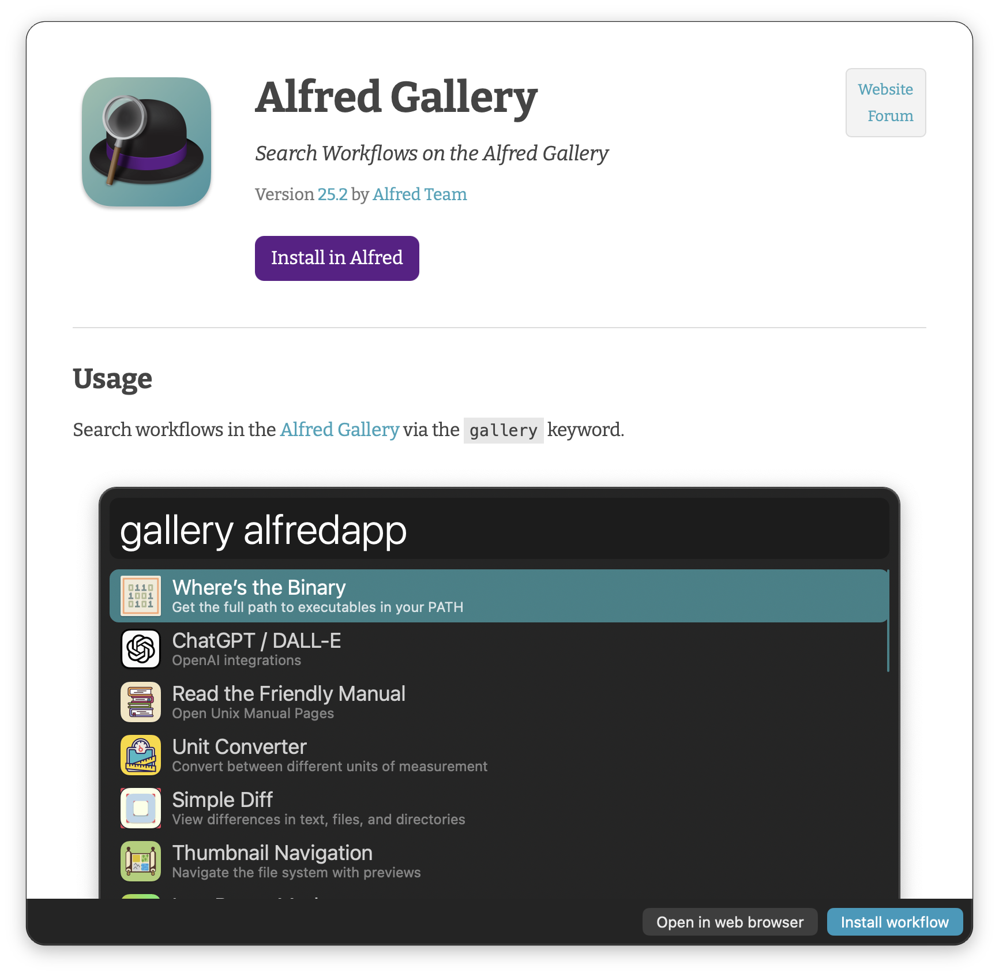

## Usage

Search workflows in the [Alfred Gallery](https://alfred.app/) via the `gallery` keyword.

* <kbd>↩</kbd> Open workflow’s Gallery page.
* <kbd>⌃</kbd> Show tags.
* <kbd>⌘</kbd><kbd>↩</kbd> Install workflow.
* <kbd>⌥</kbd><kbd>↩</kbd> Narrow search to creator’s name.
* <kbd>⇧</kbd><kbd>↩</kbd> Paste link to workflow’s Gallery page.
* <kbd>⌘</kbd><kbd>Y</kbd> Quick Look workflow’s Gallery page.

By default, workflow Gallery pages open in a webview. You can change this in the Workflow’s Configuration

* <kbd>↩</kbd> Install workflow.
* <kbd>⌘</kbd><kbd>O</kbd> Open in web browser.
