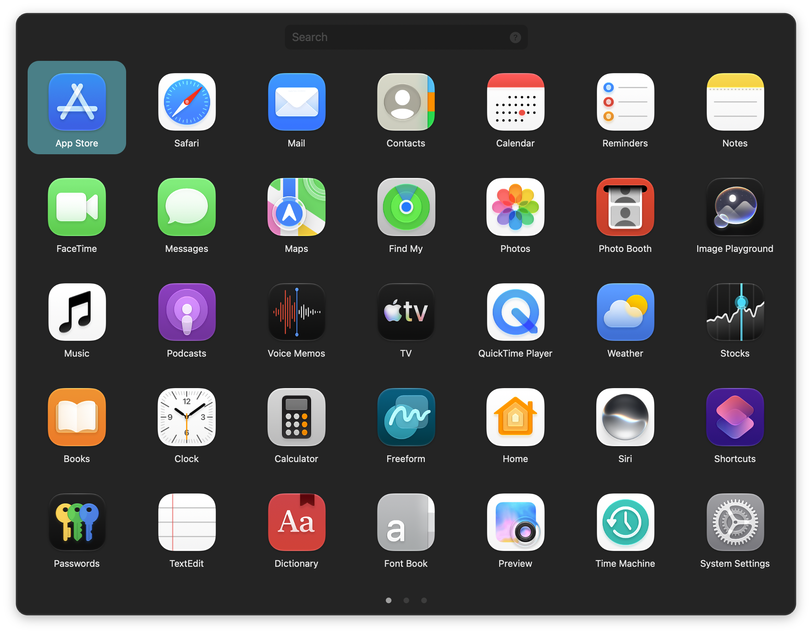

## Usage

Show a grid of apps to open via the `launchpad` keyword.

Type to filter, use the arrow keys to move and <kbd>↩</kbd> to open. Rearranging apps is keyboard-based too.

Click the `?` in the search bar or press <kbd>⌘</kbd><kbd>?</kbd> to view the cheat sheet.

Configure the Hotkey for faster triggering.
