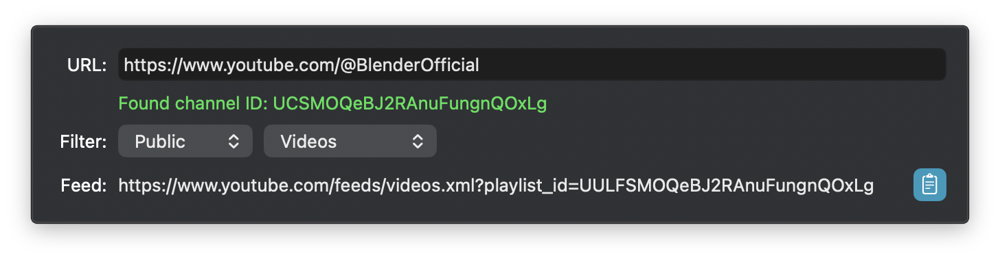

## Usage

Generate a custom YouTube RSS feed from the most recent URL in your Clipboard History or the URL in the frontmost browser tab via the `nobsyt` keyword.

Set the filter to the types of videos you want to include in the feed and press <kbd>↩</kbd> to copy it to the clipboard.
