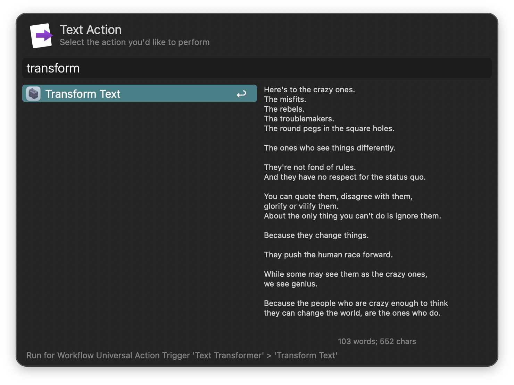
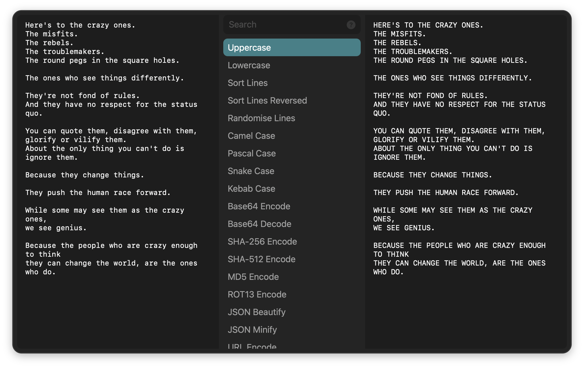
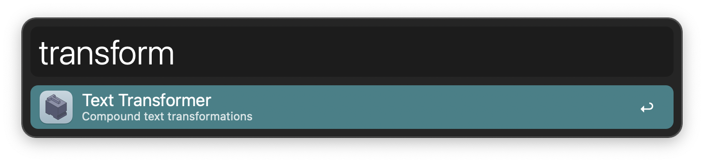

## Usage

Launch a UI to transform text to uppercase, convert to Base 64, beautify JSON, enconde as XML, and more via the Universal Action.

Input text is on the left side. Type to filter and see the resulting transformation on the right side. You can further edit the input text and send the result to the clipboard, frontmost app, or Universal Actions.

Click the `?` in the search bar or press <kbd>⌘</kbd><kbd>?</kbd> to view the cheat sheet.

Alternatively, initiate the transformation with the `transform` keyword. The text in the clipboard is used if no input is given.

Configure the Hotkey for faster triggering.
