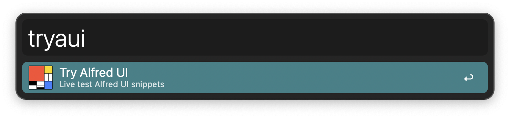
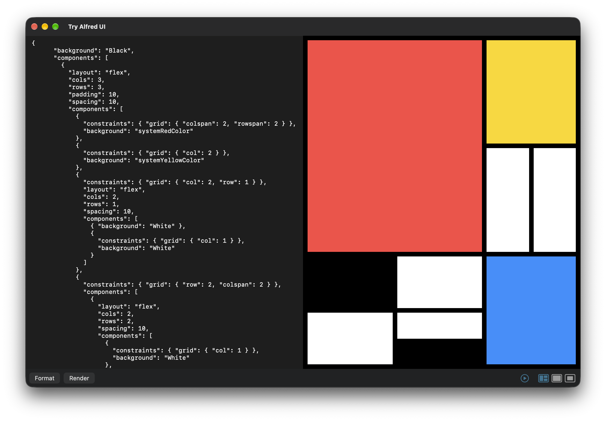
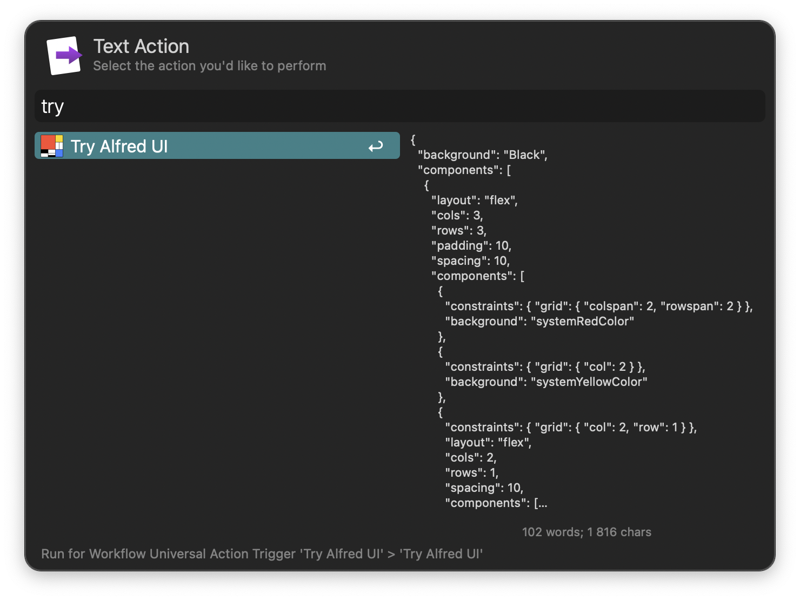

## Usage

Launch a UI to edit and live preview Alfred UI JSON via the `tryaui` keyword.

Live reloading updates the UI when you stop typing. Auto layout makes the preview’s container use the “Fit” constraints position when editing a [`view`](https://alfredapp.com/help/alfredui/components/view/) component and “Centre” for everything else.

Alternatively, launch the UI prepopulated with any selected text or from the Clipboard History via the Universal Action.

Configure the Hotkey for faster triggering.

The editor is prepopulated with either your input, clipboard, or last editor session (in that order) if any of them parse as JSON, or otherwise a default template.
