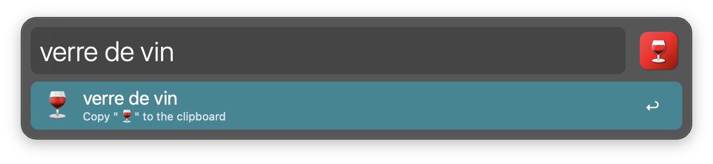
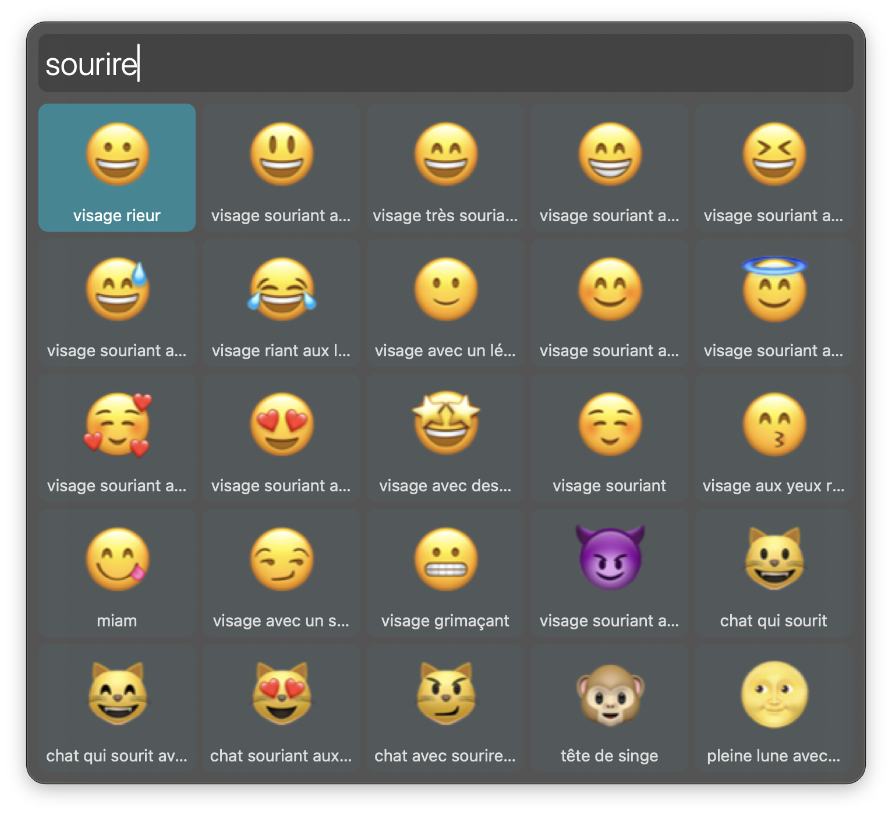
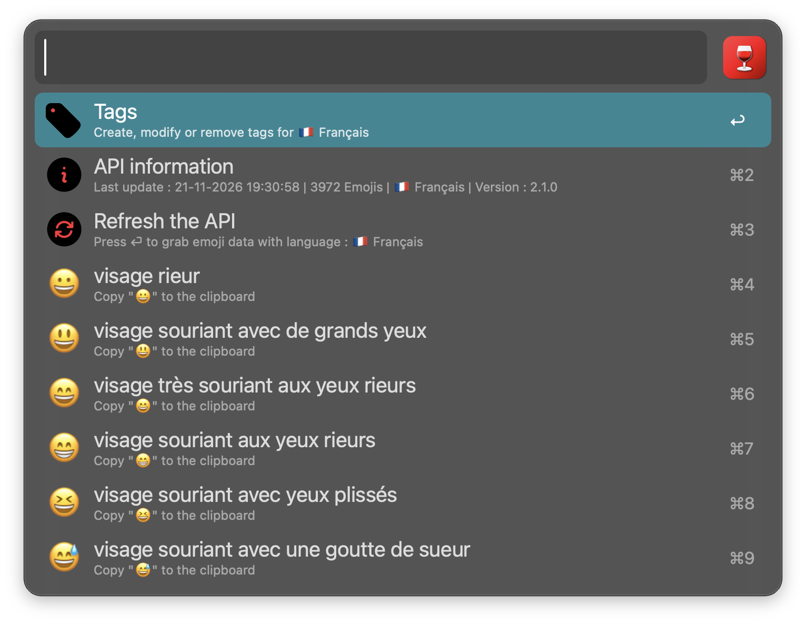
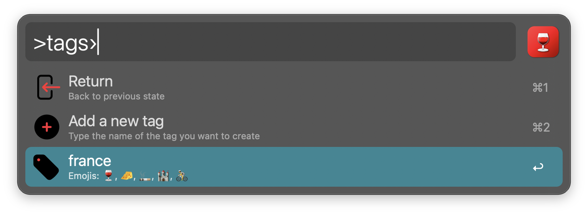

## Setup

Download the emoji data in your language: start the workflow with the `wine` keyword and choose `No API detected`.

## Usage

Search emoji via the `wine` keyword. Names and keywords come in the language defined in the Workflow’s Configuration.

* <kbd>↩</kbd> Copy emoji to the clipboard.
* <kbd>⌘</kbd><kbd>↩</kbd> Paste emoji to the frontmost application.
* <kbd>⇧</kbd><kbd>↩</kbd> Open in the online emoji dictionary defined in the Workflow’s Configuration.

In the Workflow’s Configuration you can switch to a grid search, pick a skin tone, and change or turn off the keys of each action.

### Tags and Data

`Tags`, `API information` and `Refresh the API` stay at the top of the `wine` results. Type `wine >` to open them as a menu. `Refresh the API` downloads the latest emoji data.

Tags are used to search groups of emoji with custom keywords or sentences. In `Tags`, type a name to create one, then link emoji to it.

