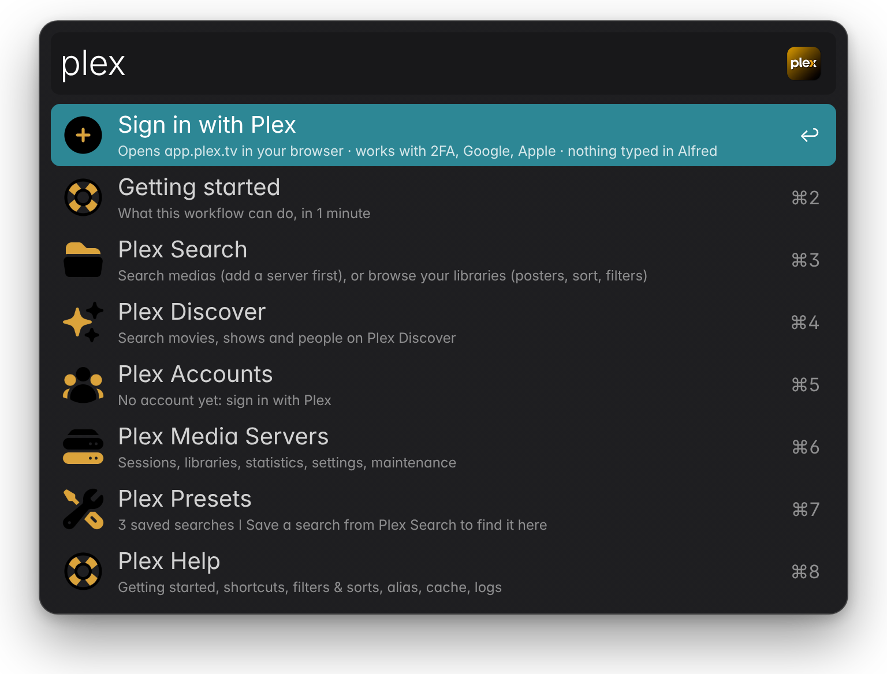
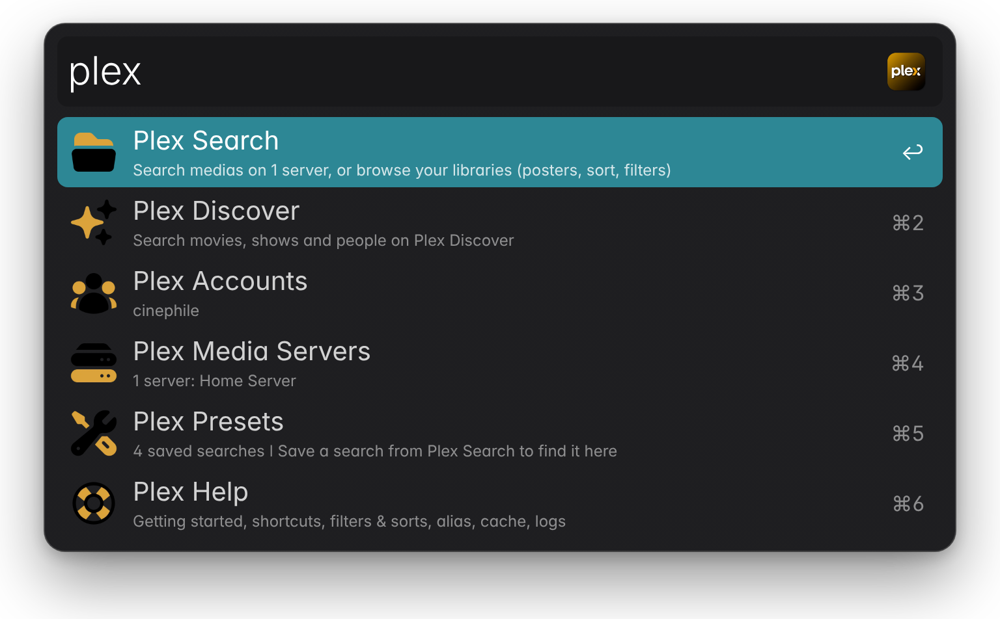
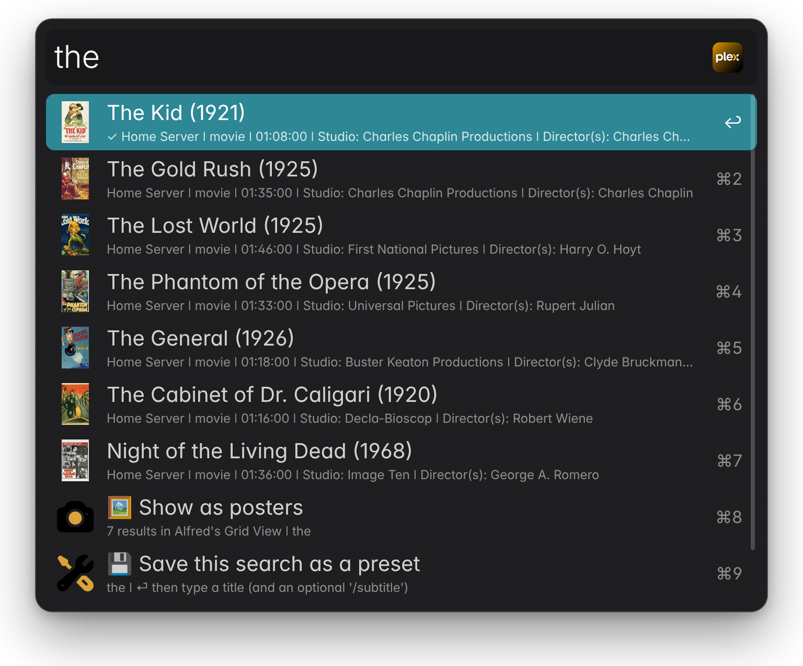
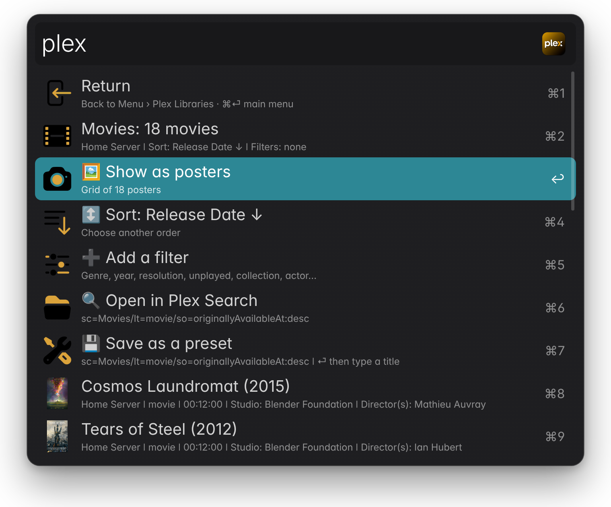
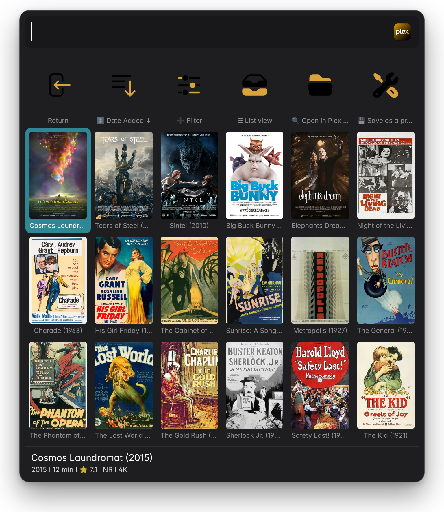
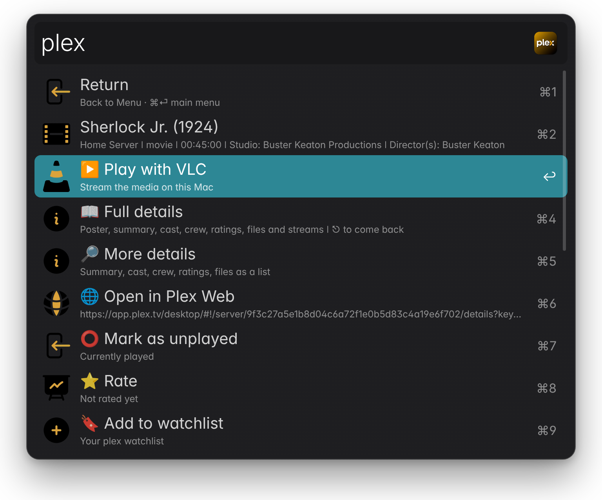
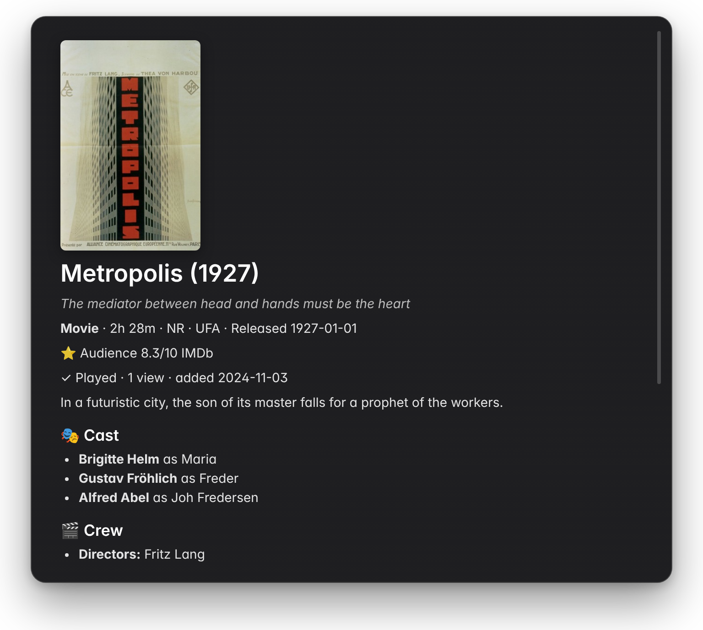
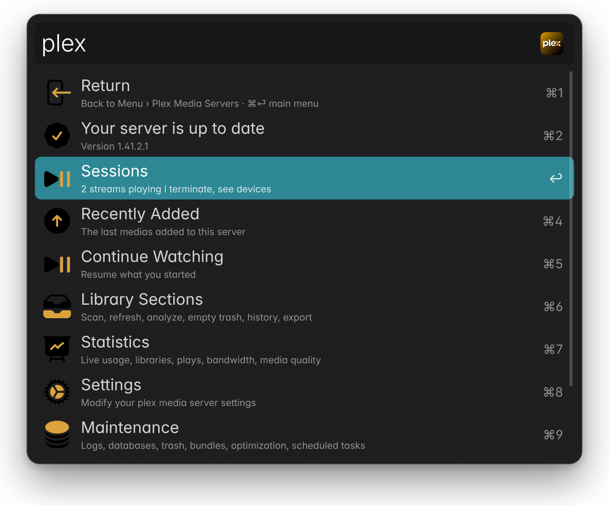
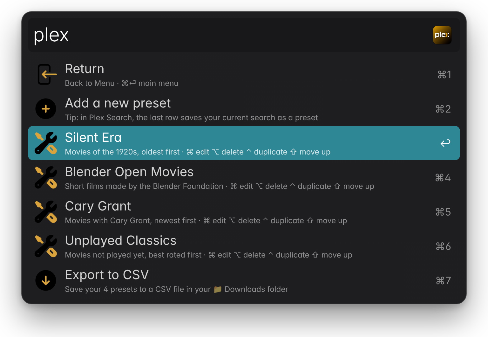

## Setup

Launch the workflow via the `plex` keyword and choose **Sign in with Plex**. Sign in on the page that opens in your browser: your servers are added automatically.

## Usage

Browse and manage your Plex Media Servers via the `plex` keyword.

Every page has a **Return** row to go back to the previous page. <kbd>⌘</kbd><kbd>↩</kbd> on it goes back to the main menu.

### Plex Search

Search media throughout your servers. Type a title, optionally followed by `/` and a type (`/movie`, `/show`, `/actor`…), or use filters for precise searches (`libtype=movie/decade=1920`).

* <kbd>↩</kbd> Show the content of the media (show, season, album, actor…), otherwise its actions.
* <kbd>fn</kbd><kbd>↩</kbd> Show the media actions.
* <kbd>⌘</kbd><kbd>↩</kbd> Open in Plex Web.
* <kbd>⌥</kbd><kbd>↩</kbd> Stream with VLC, IINA or Infuse.
* <kbd>⌃</kbd><kbd>↩</kbd> Open in [Movie and TV Show Search](https://alfred.app/workflows/tmcknight/movie-and-tv-show-search/).
* <kbd>⇧</kbd><kbd>↩</kbd> Add to or remove from the watchlist.
* <kbd>⌘</kbd><kbd>⇧</kbd><kbd>↩</kbd> Mark as played or unplayed.

Modifier keys can be changed in the Workflow’s Configuration.

With an empty query, Plex Search lists your libraries. Sort and filter them by picking from lists.

Show libraries and results as posters in a grid. In the Workflow’s Configuration you can also add posters to the lists, or show the results as a grid.

### Media Actions

Play, mark as played, rate, add to the watchlist, playlists or collections, check the files and download them from the media actions.

**Full details** shows the poster, summary, ratings, cast, crew and files. Show the full details of a media via the Universal Action.

### Plex Discover

Search movies, shows and people on Plex Discover and add them to your watchlist.

### Plex Accounts

Manage your accounts, users and devices, and clean up old devices.

### Plex Media Servers

Follow sessions, recently added media, statistics and activities. Change the settings and run maintenance tasks on your servers.

### Plex Presets

Save searches to run them again in one step. The last row of Plex Search saves the current search.

### Plex Help

Get started, check your keyboard shortcuts, filters, sorts and alias, and manage the cache and logs.

Long actions (exports, downloads, sign in) and errors end with a notification, which can be turned off in the Workflow’s Configuration.
