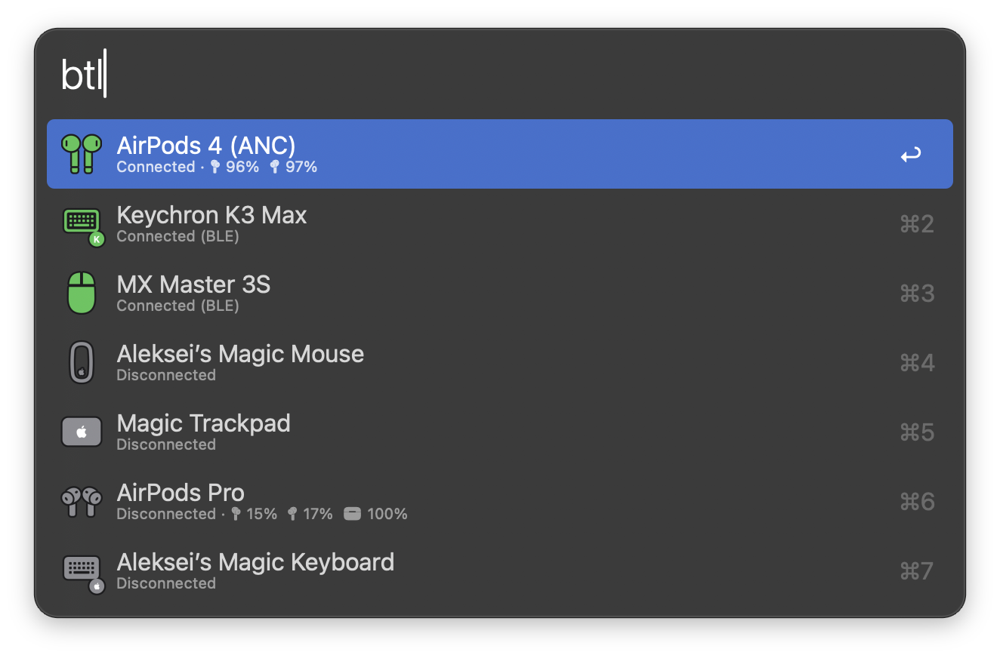
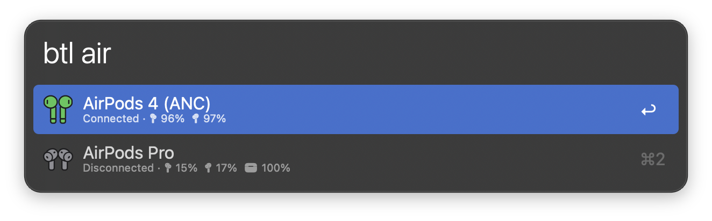
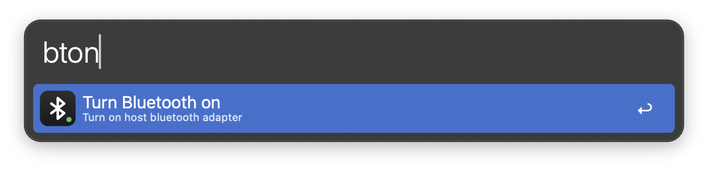

## Setup

On macOS 14 (Sonoma) and later, allow Alfred to use Bluetooth in System Settings → Privacy & Security → Bluetooth: press the ➕ button, add `Alfred 5.app`, then turn on the toggle next to it. macOS does not prompt for this permission itself, so the workflow cannot see or connect devices until it is granted. When permission is missing, the workflow says so and can open this pane for you.

## Usage

View paired Bluetooth devices via the `btl` keyword.

- <kbd>↩</kbd> Connect or disconnect the selected device.
- <kbd>⌥</kbd><kbd>↩</kbd> Star or unstar a favorite.
- <kbd>⌘</kbd><kbd>↩</kbd> Hide the selected device from the list.
- <kbd>⌃</kbd><kbd>↩</kbd> Unpair the selected device (experimental).

Type to filter the list by device name.

Turn Bluetooth on and off with the `bton` and `btoff` keywords, or toggle it with `btt`. All keywords are configurable in the Workflow’s Configuration.

Copy a diagnostics report to include in a bug report with the `btdiag` keyword. Hold <kbd>⌥</kbd> to copy a version without device names.

Bluetooth LE devices are marked `(BLE)` in the list. macOS does not allow third-party apps to disconnect them, such as the Logitech MX Master 3S or Keychron K3 Max; use Control Center to disconnect those.
