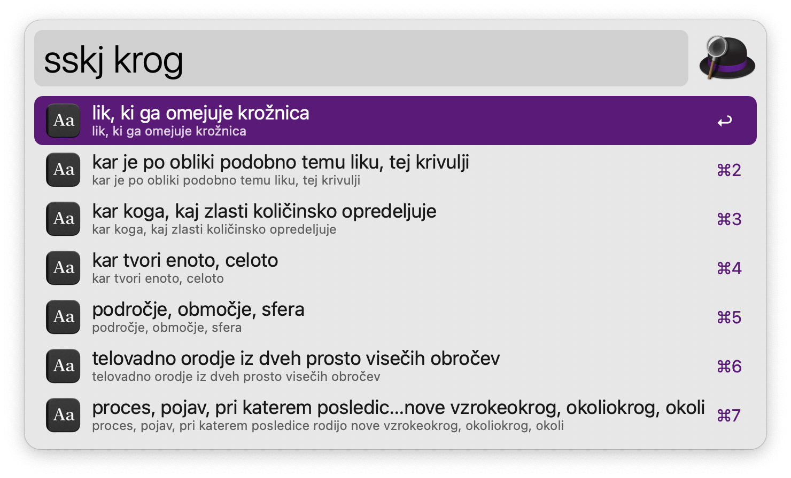
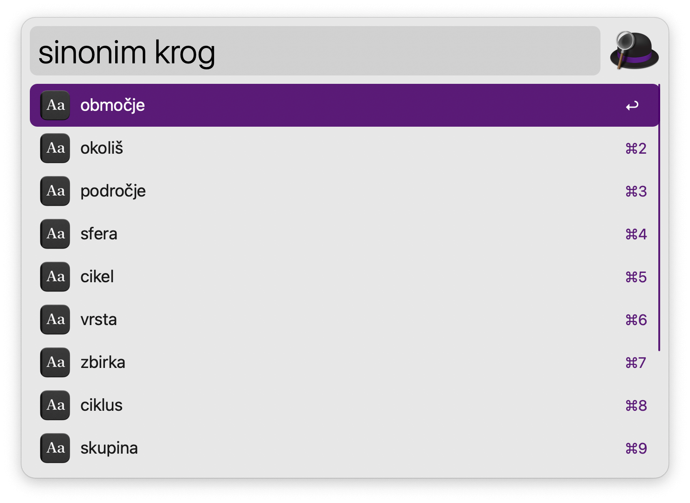
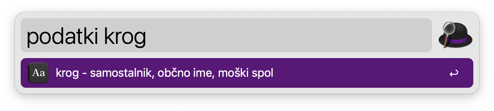
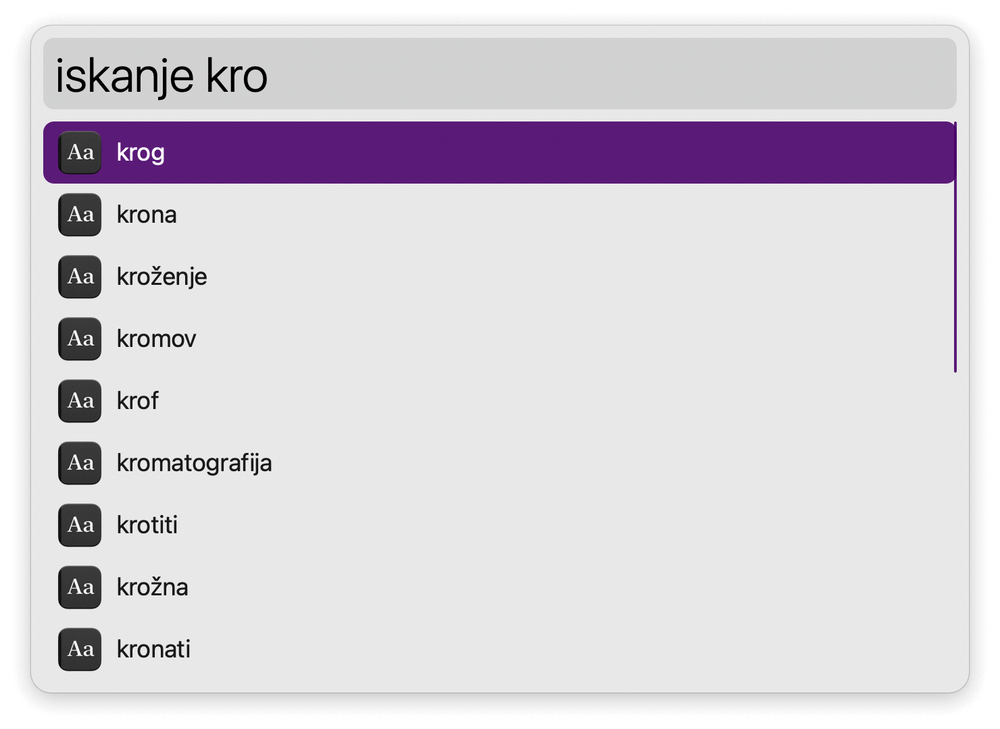

## Usage

Look up the definitions of a word from [Fran](https://fran.si) via the `sskj` keyword.

* <kbd>↩</kbd> Copy the definition.
* <kbd>⌥</kbd><kbd>↩</kbd> Open the word on Fran.

Look up the synonyms of a word from Fran's synonym dictionary via the `sinonim` keyword.

* <kbd>↩</kbd> Copy the synonym.
* <kbd>⌥</kbd><kbd>↩</kbd> Open the word in the synonym dictionary on Fran.

Look up the word type and gender from [Sloleks](https://viri.cjvt.si/sloleks/slv/) via the `podatki` keyword. Every matching entry is listed.

* <kbd>↩</kbd> Copy the word data.
* <kbd>⌥</kbd><kbd>↩</kbd> Open the entry on Sloleks.

Get live word suggestions with `iskanje`. Press <kbd>⇥</kbd> to autocomplete a suggestion.

* <kbd>↩</kbd> Show definitions.
* <kbd>⌘</kbd><kbd>↩</kbd> Show synonyms.
* <kbd>⌃</kbd><kbd>↩</kbd> Show word data.
* <kbd>⌥</kbd><kbd>↩</kbd> Open the word on Fran.
