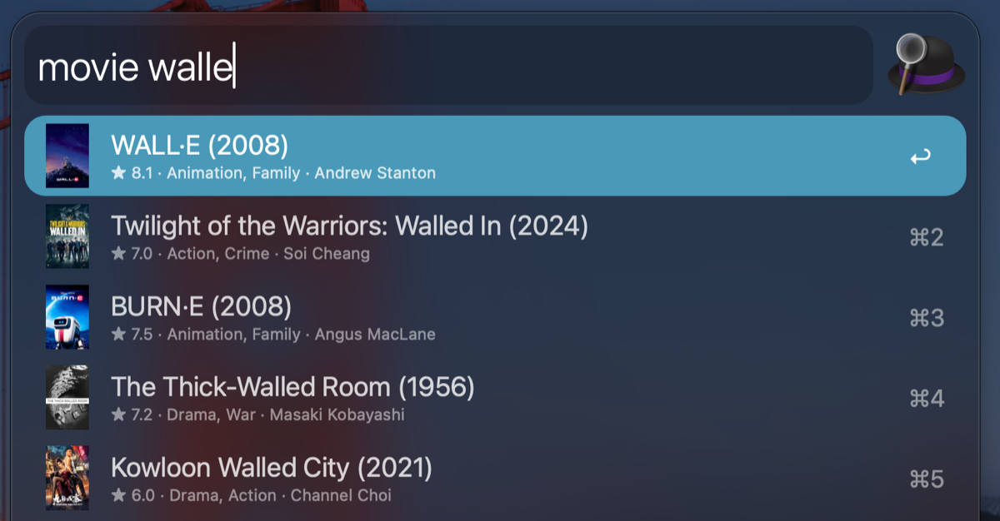
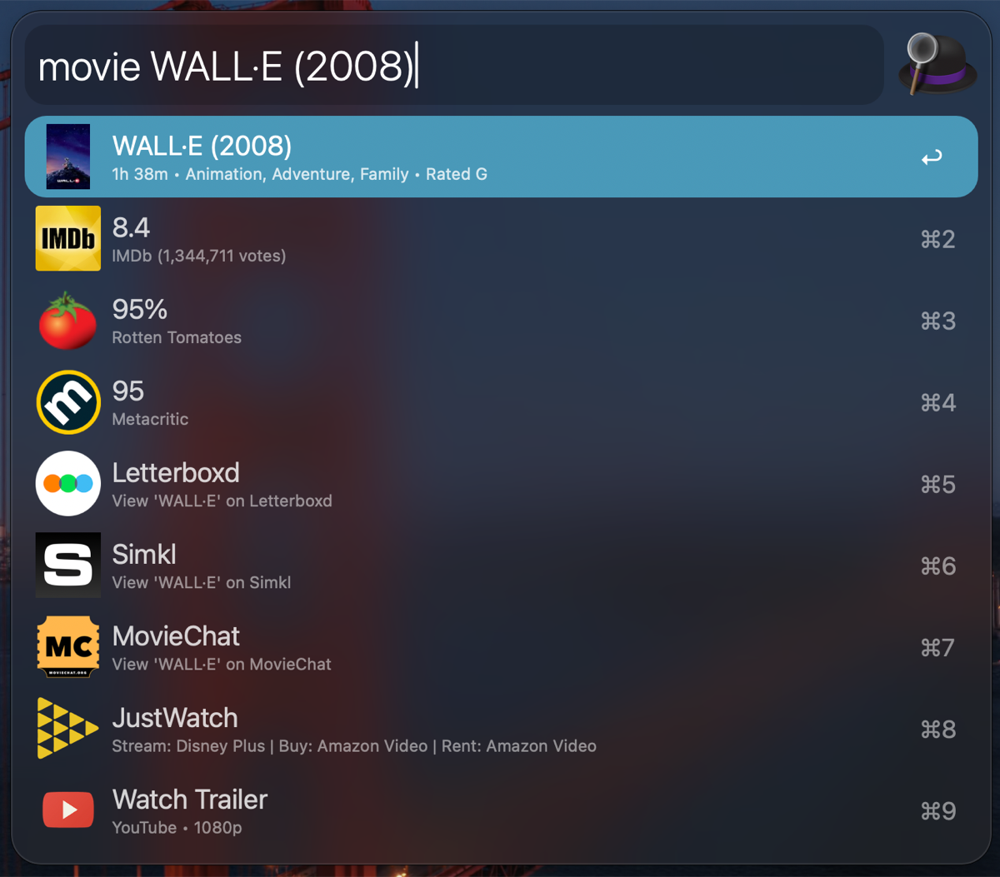
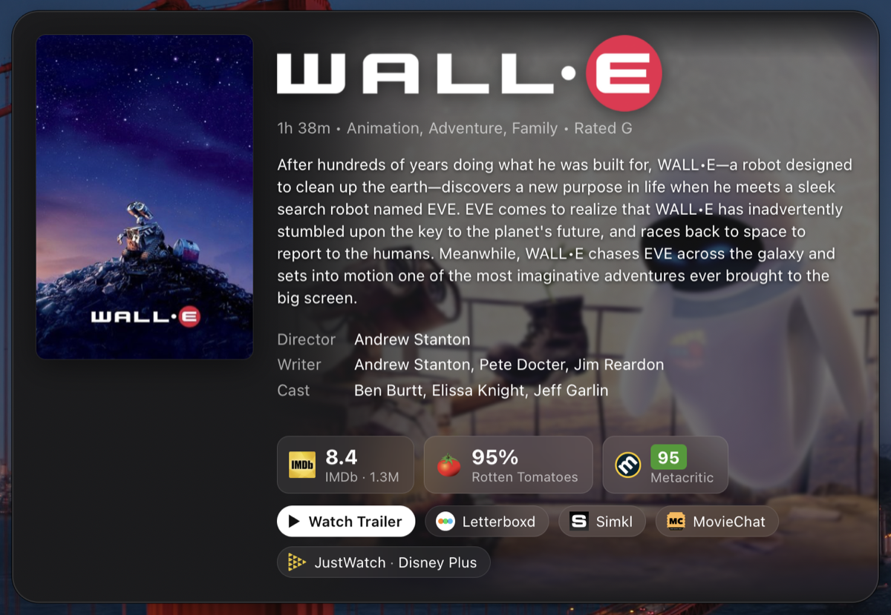

## Usage

Search for movies and TV shows via the `movie` and `tv` keywords. Results show the poster, rating, genres, and director or number of seasons.

* <kbd>↩</kbd> View details and ratings.
* <kbd>⌘</kbd><kbd>Y</kbd> Quick Look poster.

* <kbd>↩</kbd> Open entry on the respective website.
* <kbd>⌘</kbd><kbd>C</kbd> Copy the TMDb, IMDb or TheTVDB id.
* <kbd>↩</kbd> on the title row: Open the details window.

* <kbd>⌘</kbd><kbd>1</kbd> to <kbd>⌘</kbd><kbd>9</kbd> Open the ratings and links.
* <kbd>⎋</kbd>, <kbd>←</kbd> or <kbd>⌫</kbd> Go back to the details.

Trailers open on YouTube, or in their own window with **Play trailers in Alfred** turned on in the [Workflow Configuration](https://www.alfredapp.com/help/workflows/user-configuration/).

Supported services include [IMDB](https://www.imdb.com), [Rotten Tomatoes](https://www.rottentomatoes.com), [Metacritic](https://www.metacritic.com), [Letterboxd](https://letterboxd.com), [MovieChat](https://moviechat.org), [JustWatch](https://www.justwatch.com), and [Simkl](https://simkl.com).
