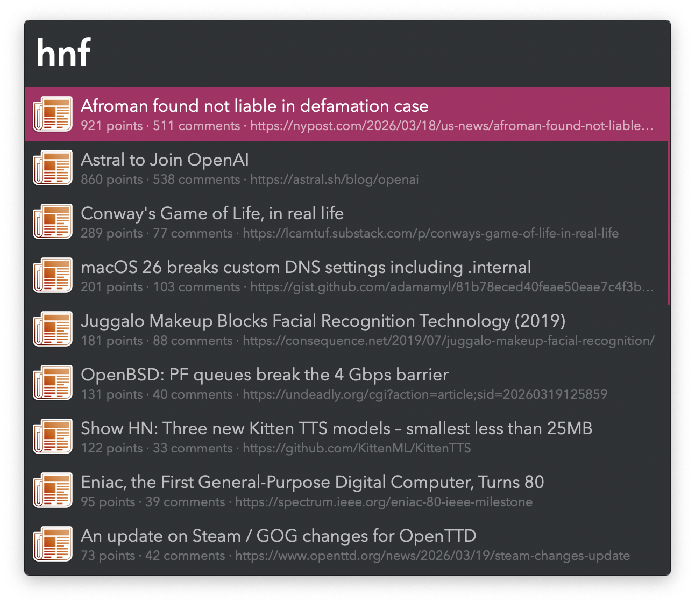
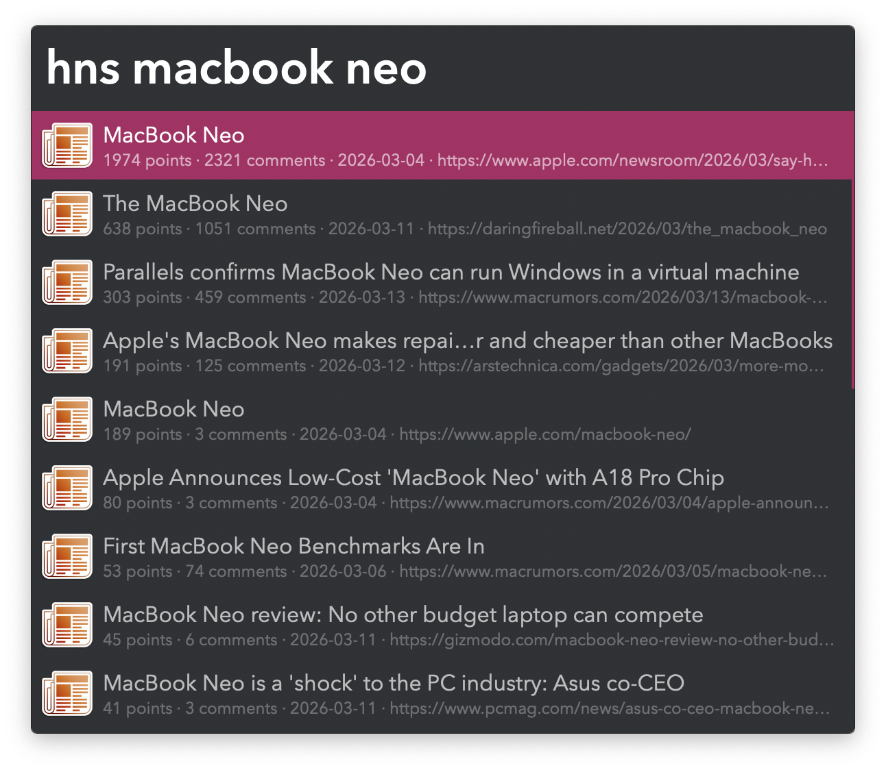
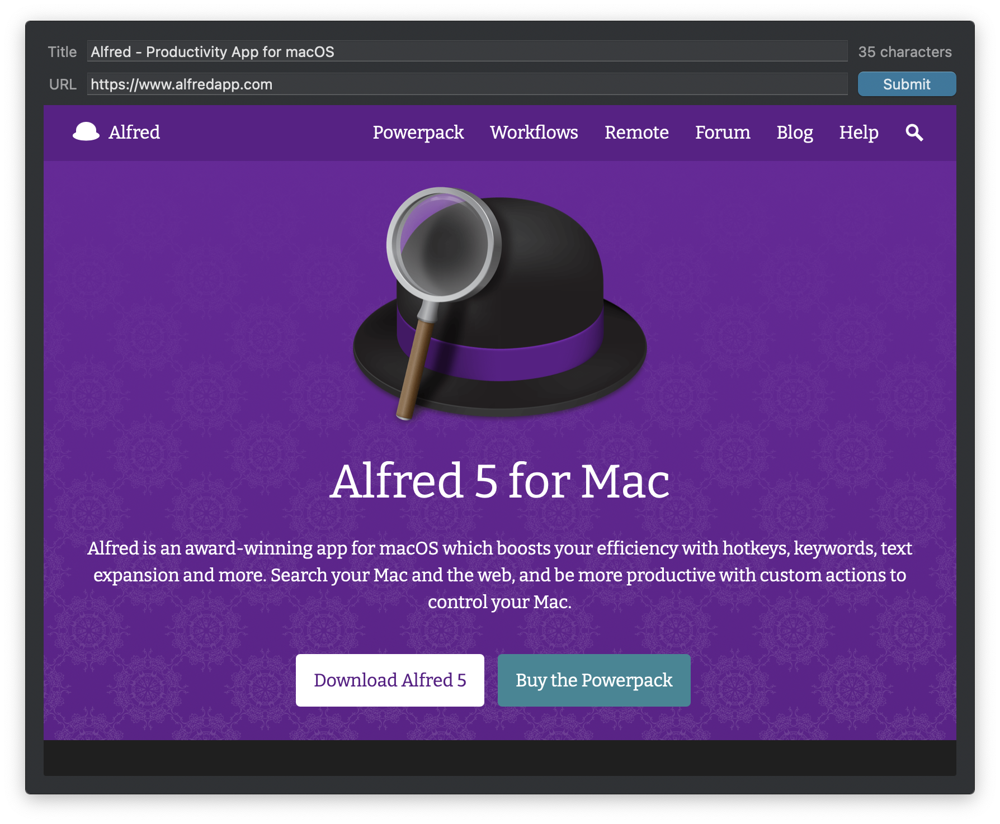
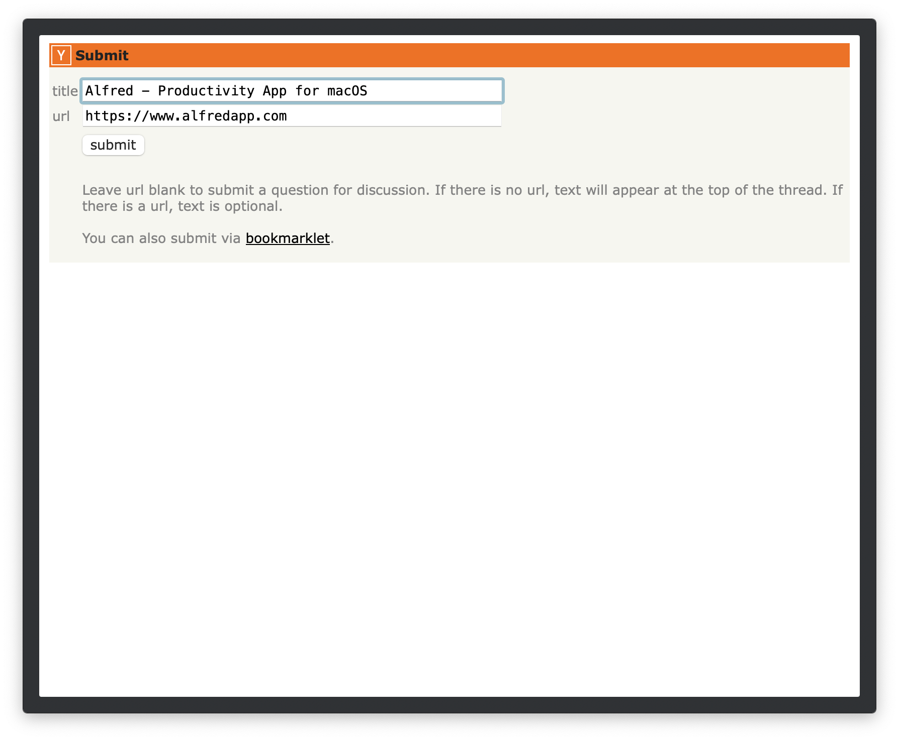
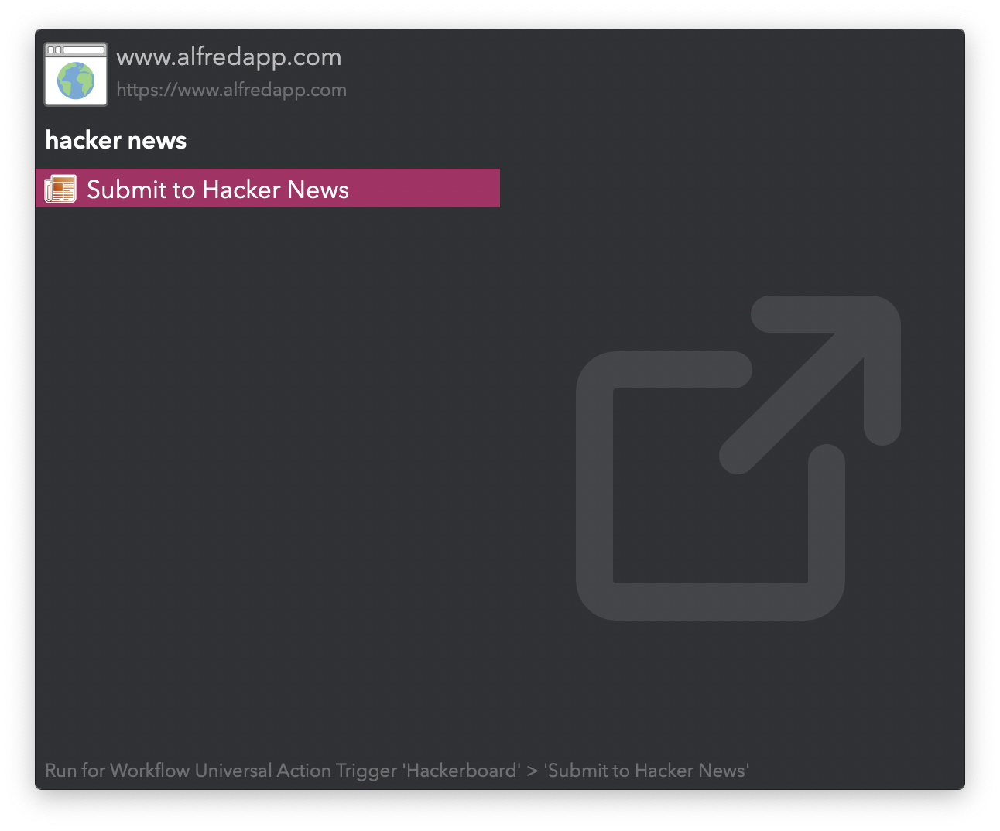

## Usage

Search the Hacker News front page via the `hnf` keyword.

Press <kbd>↩</kbd> to open the story’s website or <kbd>⌥</kbd><kbd>↩</kbd> to open the Hacker News comments thread. This behaviour can be reversed in the Workflow’s Configuration.

Seach stories with the `hns` keyword.

Previous shortcuts apply, plus <kbd>⌘</kbd><kbd>↩</kbd> switches between ordering by date (more recent first) and by relevance (then points, then number of comments).

Submit the frontmost browser tab with the `hnsubmit` keyword.

* <kbd>↩</kbd> Submit (when a text field is focused).
* <kbd>⌘</kbd><kbd>↩</kbd> Submit (when the webview is focused).
* <kbd>⌘</kbd><kbd>P</kbd> Focus title field.
* <kbd>⌘</kbd><kbd>L</kbd> Focus URL field.

<kbd>⌘</kbd><kbd>O</kbd> Open current page in web browser.

Alternatively, submit a URL via the Universal Action.

